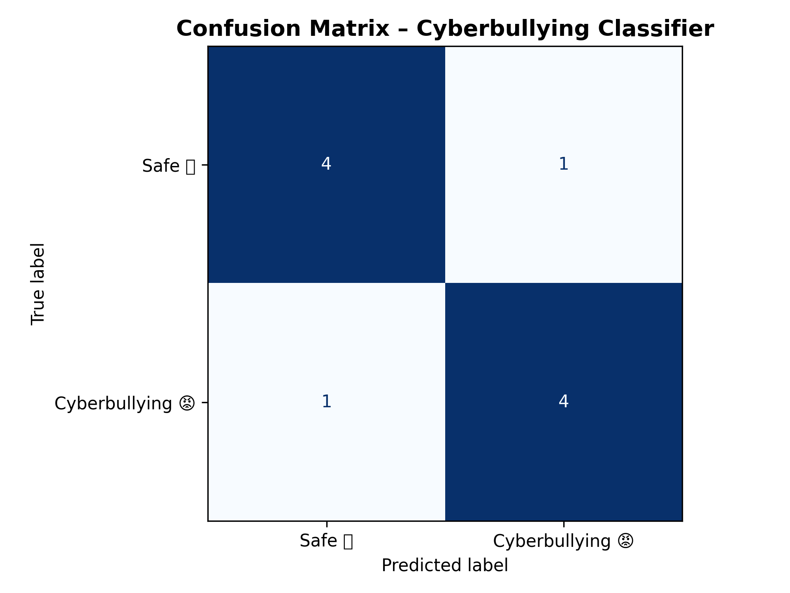

# Hinglish & Gen-Z Cyberbullying Detection

### AI-Powered Multilingual Cyberbullying Detection Using XLM-RoBERTa

A machine learning-based cyberbullying detection system designed to identify harmful messages written in **Hinglish (Hindi-English), Gen-Z slang, and emoji-based communication**.

The project uses a fine-tuned **XLM-RoBERTa transformer model** to classify text as either **Cyberbullying** or **Safe/Neutral**, with an interactive application built using Streamlit.

## Project Overview

Traditional cyberbullying detection systems often focus on formal English text. However, social media communication increasingly involves code-mixed languages, abbreviations, internet slang, and emojis.

For example, expressions such as "L + ratio," "NPC," and mixed Hindi-English insults can be difficult for conventional text classification systems to interpret.

This project explores the use of multilingual natural language processing to identify potentially harmful communication across these informal language patterns.

### Objectives

- Detect cyberbullying in Hinglish and English text.
- Recognize harmful expressions involving Gen-Z slang.
- Support text containing emojis and informal internet language.
- Classify messages as Safe/Neutral or Cyberbullying.
- Display model predictions with confidence scores.
- Provide an accessible interface for testing text.

## Technologies Used

| Technology | Purpose |
|---|---|
| Python | Core application and ML development |
| XLM-RoBERTa | Multilingual transformer classification |
| Hugging Face Transformers | Model training and inference |
| PyTorch | Deep learning framework |
| Streamlit | Interactive application |
| Scikit-learn | Evaluation metrics |
| Pandas and NumPy | Dataset processing |
| Hugging Face Datasets | Dataset management |
| Matplotlib | Evaluation visualization |
| Emoji and text-unidecode | Text preprocessing |

## System Architecture

The system follows a supervised machine learning pipeline:

1. **Dataset Collection:** Gather Hinglish, Gen-Z slang, and emoji-containing text samples.
2. **Data Preprocessing:** Normalize text, handle URLs and usernames, and clean inconsistent input.
3. **Tokenization:** Convert text into token representations using the XLM-RoBERTa tokenizer.
4. **Model Fine-Tuning:** Train XLM-RoBERTa for binary classification.
5. **Evaluation:** Calculate accuracy, precision, recall, and F1-score.
6. **Prediction:** Classify new user-provided messages.
7. **User Interface:** Display predictions and confidence scores through Streamlit.

## Model Training

The project fine-tunes `xlm-roberta-base` using Hugging Face Transformers and PyTorch.

Training configuration:

| Parameter | Value |
|---|---|
| Base model | xlm-roberta-base |
| Classification labels | 2 |
| Training epochs | 3 |
| Learning rate | 2e-5 |
| Training batch size | 16 |
| Evaluation batch size | 16 |
| Maximum sequence length | 128 |
| Weight decay | 0.01 |
| Dataset split | 80% training / 20% testing |
| Model selection metric | F1-score |

The trained model is saved to `outputs/final_model`.

## Model Evaluation

The provided confusion matrix shows the following results:

| Actual / Predicted | Safe | Cyberbullying |
|---|---:|---:|
| Safe | 4 | 1 |
| Cyberbullying | 1 | 4 |

**Results from the provided 10-example evaluation:**

- Accuracy: 80%
- Precision: 80%
- Recall: 80%
- F1-score: 80%

The model correctly classified 8 out of 10 examples in this evaluation.

These results demonstrate preliminary classification capability, but the evaluation sample is small. Larger, independently held-out datasets are necessary to assess generalization and real-world performance.



## Key Development Challenges and Solutions

### 1. Code-Mixed Language Processing

**Challenge:** Hinglish combines Hindi and English vocabulary, often with inconsistent spelling and grammar.

**Approach:** Used the multilingual XLM-RoBERTa architecture, which supports text representations across multiple languages.

### 2. Gen-Z Slang Interpretation

**Challenge:** Internet slang includes abbreviations, informal expressions, and context-dependent language that conventional keyword filtering may misinterpret.

**Approach:** Incorporated slang-oriented examples into dataset preparation and used transformer-based text classification rather than relying exclusively on keyword matching.

### 3. Dataset Cleaning and Formatting

**Challenge:** Source datasets contained inconsistent CSV formatting and potentially invalid records.

**Solution:** Implemented Python-based data cleaning and loading functions to extract text-label pairs, normalize dataset structure, and prepare data for training.

### 4. Model Loading and Compatibility

**Challenge:** Loading saved transformer checkpoints consistently across local environments can introduce compatibility and memory-handling issues.

**Solution:** Implemented model export and local loading procedures, including CPU-based inference and saved tokenizer/model artifacts.

### 5. Interactive Prediction

**Challenge:** Making a trained NLP model accessible without requiring users to execute Python scripts.

**Solution:** Developed a Streamlit interface allowing users to enter text, receive classifications, and view confidence scores.

## Project Structure

```text
cyberbully-detector/
│
├── app.py
├── requirements.txt
├── metricstest.py
├── export_fixed_model.py
├── confusion_matrix.png
├── README.md
├── .gitignore
│
└── src/
    ├── __init__.py
    ├── dataset.py
    ├── genz_datasets.py
    ├── preprocess.py
    ├── predict.py
    ├── train.py
    └── config/
        └── default.yaml
```

Training datasets, model checkpoints, virtual environments, and large model files are excluded from the GitHub repository.

## Installation and Setup

### Prerequisites

- Python 3.10 recommended
- pip
- Git
- Sufficient memory and storage for XLM-RoBERTa training

### 1. Clone the Repository

```bash
git clone https://github.com/Nailahzel/Hinglish-GenZ-Cyberbullying-Detection.git
cd Hinglish-GenZ-Cyberbullying-Detection
```

### 2. Create a Virtual Environment

```bash
python -m venv .venv
```

Activate it on Windows:

```powershell
.venv\Scripts\Activate.ps1
```

### 3. Install Dependencies

```bash
pip install -r requirements.txt
pip install streamlit text-unidecode
```

### 4. Prepare the Training Dataset

Place authorized datasets in:

```text
data/raw/
```

The training code expects CSV files containing text and binary labels:

- `0` — Safe/Neutral
- `1` — Cyberbullying

### 5. Train the Model

```bash
python -m src.train
```

The training script saves the fine-tuned model under:

```text
outputs/final_model/
```

**Note:** The trained model weights and datasets are not included in this repository. Training requires suitable data and computational resources. The provided scripts have not been independently verified to reproduce the displayed evaluation results from a fresh installation.

### 6. Run the Streamlit Application

```bash
streamlit run app.py
```

Open the local Streamlit URL displayed in the terminal.

Enter a message and click **Analyze** to receive a predicted class and model confidence score.

## Current Limitations

- Detection accuracy depends on dataset coverage and labeling quality.
- Internet slang changes rapidly, requiring periodic dataset updates.
- Context-dependent expressions, sarcasm, and reclaimed language may be misclassified.
- Classifier confidence is not a guarantee that the prediction is correct.
- The provided confusion matrix contains only 10 evaluated examples.
- Model weights and original datasets are not distributed with this repository.
- The system is a research prototype and should not be treated as a fully validated content-moderation service.

## Future Improvements

- Expand the Hinglish and Gen-Z training datasets.
- Evaluate performance on larger independent test datasets.
- Add multilingual and context-aware evaluation.
- Improve handling of sarcasm and ambiguous slang.
- Introduce additional classification categories and severity levels.
- Explore model compression to reduce inference requirements.
- Deploy a hosted demonstration with documented model availability.

## Applications

Potential use cases include social media moderation research, online community safety tools, educational demonstrations of multilingual NLP, and content classification experiments.

## Project Status

**Research prototype / local application**

The project includes model training, evaluation, preprocessing, inference scripts, and a Streamlit interface. Public deployment has not been verified.

## Author

Developed as an AI and NLP project exploring multilingual cyberbullying detection and safer digital communication.

**GitHub:** [Nailahzel](https://github.com/Nailahzel)

**Repository:** [Hinglish-GenZ-Cyberbullying-Detection](https://github.com/Nailahzel/Hinglish-GenZ-Cyberbullying-Detection)
